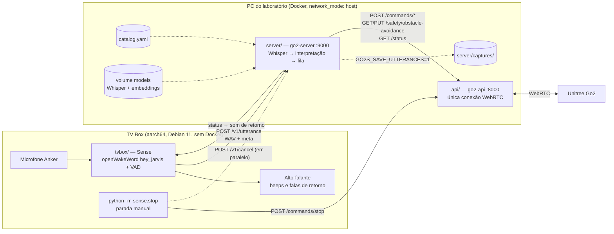
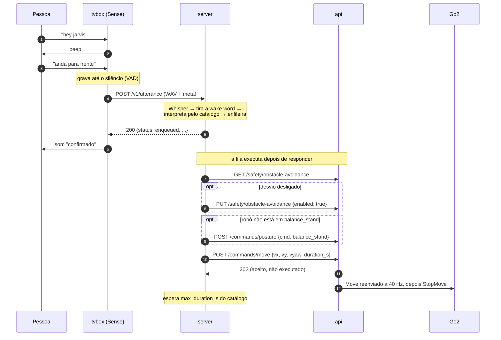
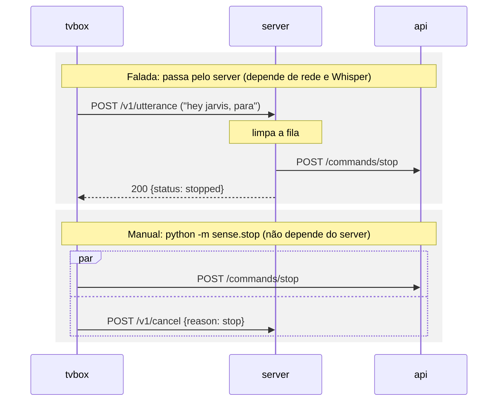
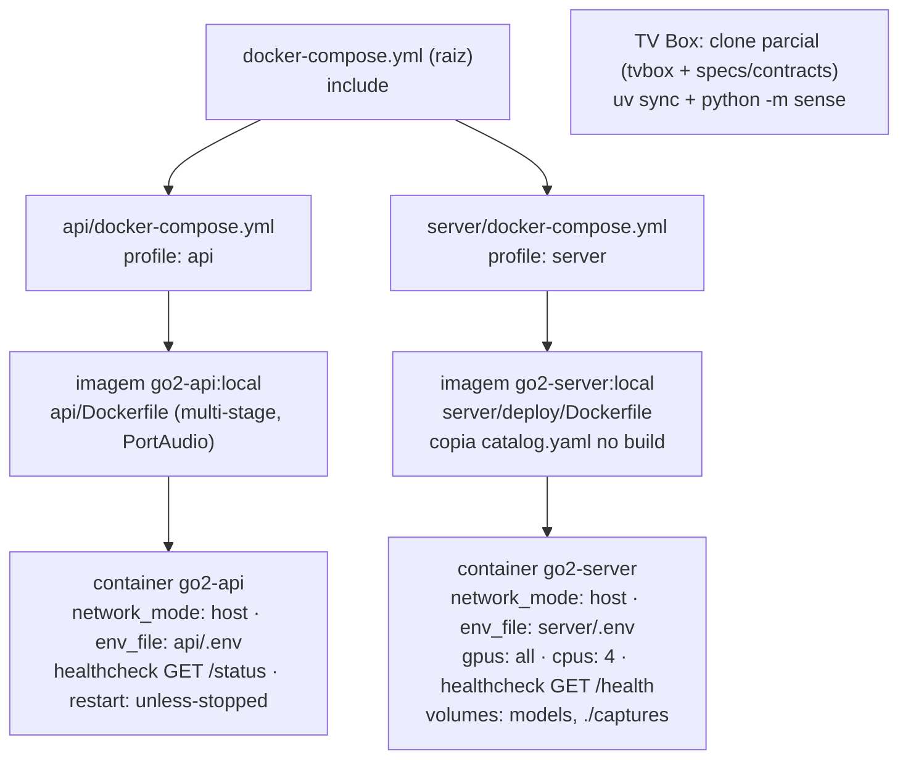
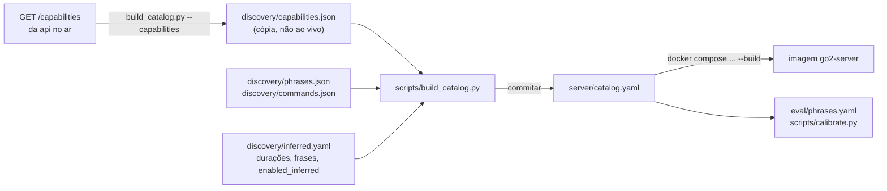
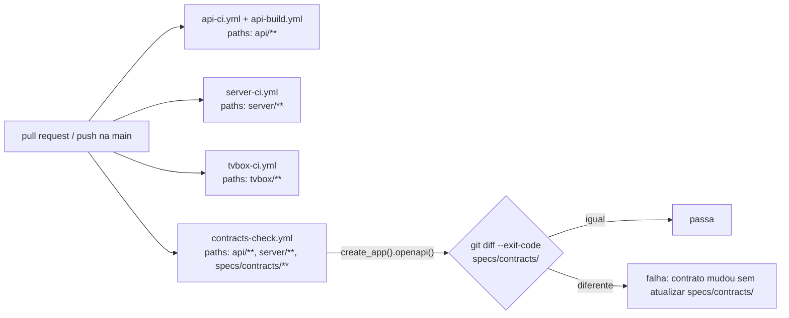

# Arquitetura

Três serviços independentes que só conversam por HTTP. Nenhum importa código de outro; os contratos estão em [`specs/contracts/`](../specs/contracts/).

## Visão geral

| Serviço | Onde roda | Porta | Fala com |
|---|---|---|---|
| `api/` | PC, container `go2-api` | 8000 | Go2 (WebRTC); recebe do server e do `sense.stop` |
| `server/` | PC, container `go2-server` | 9000 | api; recebe do tvbox |
| `tvbox/` | TV Box, com `uv` direto | — (só cliente) | server; api só no `sense.stop` |

## Um comando de voz

A resposta do server à TV Box só diz se a frase virou comando (`enqueued`, `rejected`, `stopped` ou `ignored`). Ela não espera o robô executar.

## Parada

## Docker e deploy

- `network_mode: host`, só em Linux: a api precisa enxergar a LAN do robô (descoberta por multicast e WebRTC), e o server fala com ela por `127.0.0.1:8000`.
- O healthcheck da api diz se ela responde, não se o robô está conectado: isso é o campo `connected` de `GET /status`.
- `docker compose --profile api --profile server up -d --build` na raiz sobe os dois; cada pasta também sobe sozinha com o próprio perfil.

## Catálogo (antes de rodar, manual)

Nada regenera o catálogo sozinho. Editar `discovery/` sem rodar o `build_catalog.py` (e sem rebuild da imagem) deixa o robô com o catálogo antigo.

## CI e contratos

| Contrato | Dono | Consumidores |
|---|---|---|
| `specs/contracts/api.openapi.json` | api | server; tvbox (só `POST /commands/stop`) |
| `specs/contracts/server.openapi.json` | server | tvbox (`/v1/utterance`, `/v1/cancel`) |
