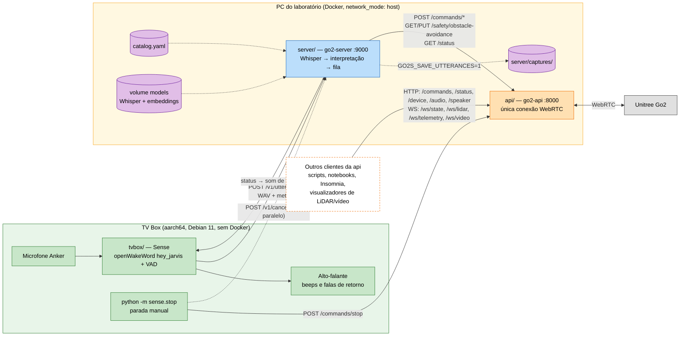
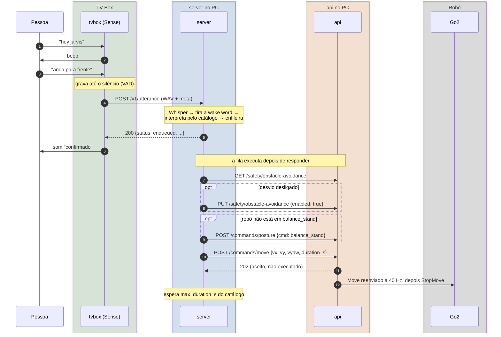
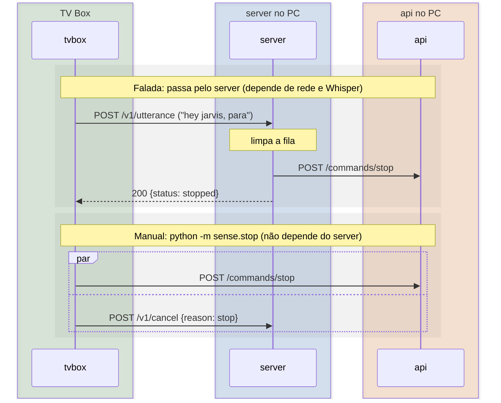
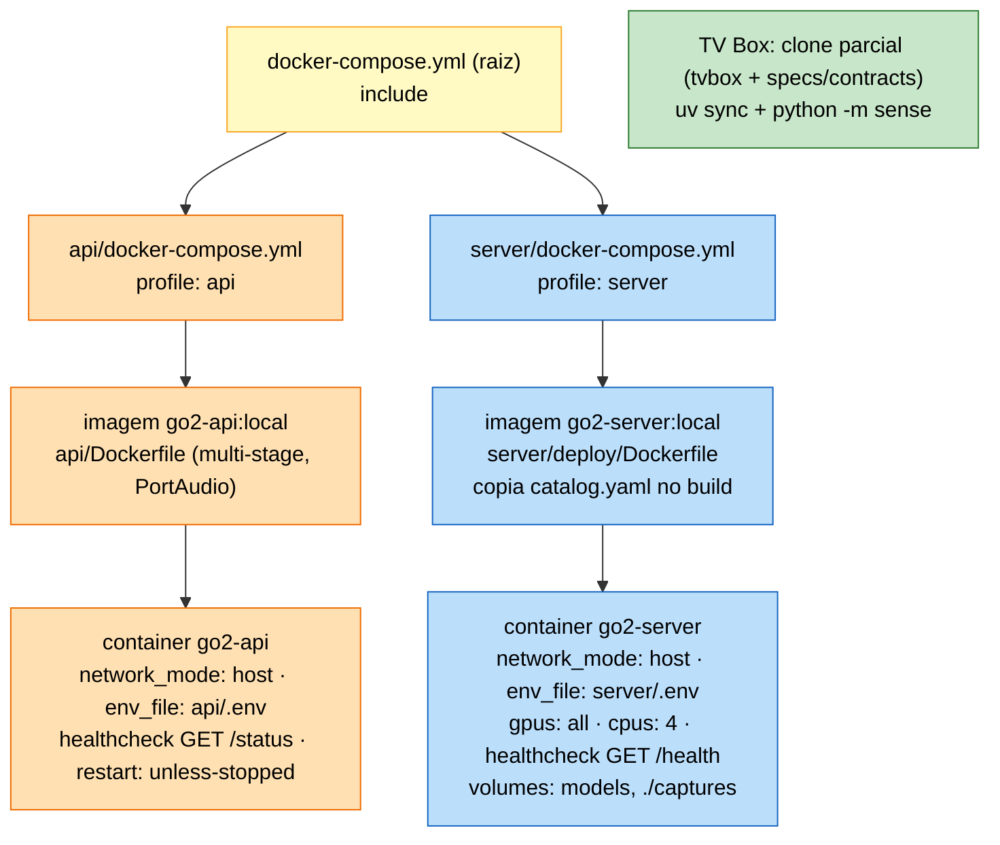
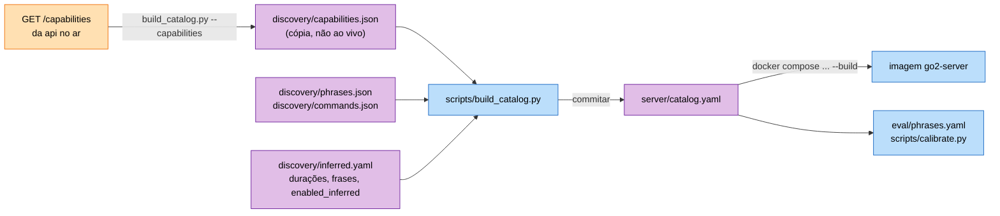
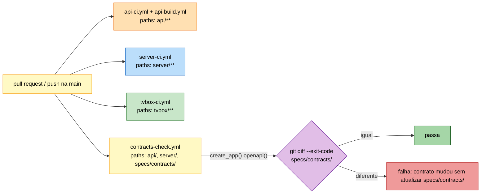

# Arquitetura

Três serviços independentes que só conversam por HTTP. Nenhum importa código de outro; os contratos estão em [`specs/contracts/`](../specs/contracts/).

Cores em todos os diagramas: 🟩 tvbox · 🟦 server · 🟧 api · ⬜ Go2 · 🟪 dados e arquivos · 🟨 Docker e CI.

## Visão geral

| Serviço | Onde roda | Porta | Fala com |
|---|---|---|---|
| `api/` | PC, container `go2-api` | 8000 | Go2 (WebRTC); recebe do server, do `sense.stop` e de qualquer cliente na rede |
| `server/` | PC, container `go2-server` | 9000 | api; recebe do tvbox |
| `tvbox/` | TV Box, com `uv` direto | — (só cliente) | server; api só no `sense.stop` |

## A api sozinha

A api também é um produto à parte: quem quer só controlar ou observar o Go2 clona só `api/` (e `specs/contracts/`) e não precisa do server nem da TV Box. Passo a passo em [`api/README.md`](../api/README.md).

| Grupo | Rotas | Spec |
|---|---|---|
| Movimento | `/commands/posture`, `/commands/gesture`, `/commands/move`, `/commands/stop`, `/commands/speed`, `/safety/obstacle-avoidance` | — (anterior às specs) |
| Estado e sensores | `GET /status` (bateria, IMU, motores, configurações, erros), `/ws/state` | F-004 |
| Lanterna, LED e volume | `/device/brightness`, `/device/led`, `/device/volume` | F-005 |
| Áudio | `/speaker/*` (tocar na hora), `/audio/*` (biblioteca do robô, `/audio/silence`) | F-006, F-007 |
| Streams | `/ws/lidar`, `/ws/telemetry`, `/ws/video` | F-001, F-002, F-003 |

O que a lib oferece e ficou de fora, com o motivo, está em [`api/docs/cobertura_lib.md`](../api/docs/cobertura_lib.md). Truques, modo bípede, MCF e controle de motor direto estão restritos pelo `AGENTS.md`. Todas as rotas, com exemplos, estão na coleção do Insomnia (`api/insomnia/go2-api.json`).

## Um comando de voz

A resposta do server à TV Box só diz se a frase virou comando (`enqueued`, `rejected`, `stopped` ou `ignored`). Ela não espera o robô executar.

## Parada

## Docker e deploy

- `network_mode: host`, só em Linux: a api precisa enxergar a LAN do robô (descoberta por multicast e WebRTC), e o server fala com ela por `127.0.0.1:8000`.
- O healthcheck da api diz se ela responde, não se o robô está conectado: isso é o campo `connected` de `GET /status`.
- `docker compose --profile api --profile server up --build` na raiz sobe os dois; cada pasta também sobe sozinha com o próprio perfil.

## Catálogo (antes de rodar, manual)

Nada regenera o catálogo sozinho. Editar `discovery/` sem rodar o `build_catalog.py` (e sem rebuild da imagem) deixa o robô com o catálogo antigo.

## CI e contratos

| Contrato | Dono | Consumidores |
|---|---|---|
| `specs/contracts/api.openapi.json` | api | server; tvbox (só `POST /commands/stop`) |
| `specs/contracts/server.openapi.json` | server | tvbox (`/v1/utterance`, `/v1/cancel`) |
